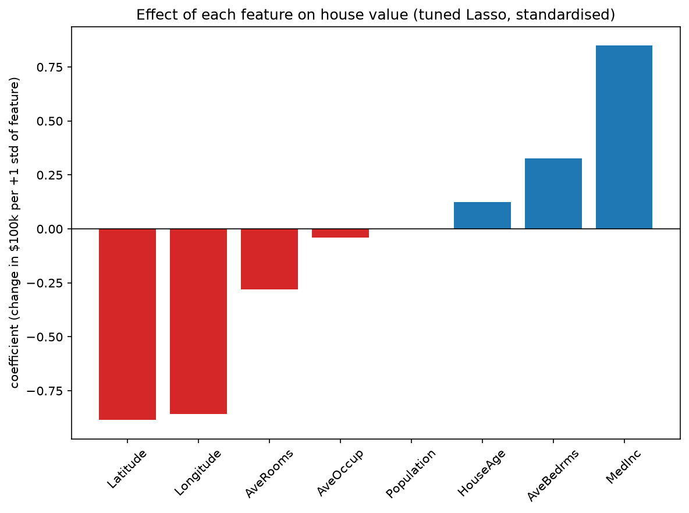

# Predicting California House Prices: An Honest Linear Model Pipeline

Week 5 project, CodeTrade AI/ML Internship. A complete linear-model workflow with a baseline, plain regression,
Ridge, Lasso, cross-validated tuning, interpretation, and a single final test evaluation.

## Dataset
`data/california_housing.csv`: 20,640 census block groups (1990 US Census, California), 8 numeric features, same
columns as scikit-learn's California Housing dataset (`MedInc, HouseAge, AveRooms, AveBedrms, Population, AveOccup, Latitude, Longitude`).
**Source:** ___ (write where you got the file).
Target: `MedHouseVal`, the median house value in units of $100,000 (capped at 5.0).

Missing values: `AveBedrms` has 207 gaps in this copy. They are filled with the training-data median using `SimpleImputer`
inside every pipeline, so no information leaks from validation or test data. (`python download_data.py` saves the
exact scikit-learn copy, which has no gaps; the notebook works with either.)

## What I built
1. Explored the data and the target distribution (note the cap at $500k)
2. Split once (80/20, `random_state=42`) and froze the test set
3. Dummy baseline (predict the mean) as the performance floor
4. Plain `LinearRegression` to compare against the baseline
5. Scaled Ridge and Lasso with default alpha
6. Tuned alpha with `LassoCV` / `RidgeCV` (training data only)
7. Wrapped the final model in one `Pipeline` (scaler + LassoCV), which prevents leakage
8. Interpreted standardised coefficients with a bar chart
9. Evaluated on the test set exactly once and built the comparison table

## Results
> Fill these in from your own run of the notebook.

| Model | CV R2 (mean) | Test R2 |
|---|---|---|
| Baseline (mean) | ___ | not evaluated |
| Plain LinearRegression | ___ | not evaluated |
| Ridge (alpha=1) | ___ | not evaluated |
| Lasso (alpha=1) | ___ | not evaluated |
| Ridge tuned | ___ | not evaluated |
| **Lasso tuned (final pipeline)** | ___ | **___** |

Full table: `outputs/comparison_table.csv`

## Interpretation
> Replace with your 3-4 bullets from Task 08. Example structure:
- Median income is the strongest positive driver of house value.
- Latitude and longitude carry large effects, so location matters a lot.
- ___ features had near-zero effect.
- Caveat: coefficients show association, not causation, and correlated features share credit.



## Key takeaways
- The baseline R2 is about 0, so every real model has to beat that floor.
- With 8 features and 16,000+ training rows, regularisation changes the score very little. Tuned Ridge and Lasso end up close to plain regression.
- CV and test R2 were close, so the estimate was honest (no leakage, no test-set tuning).
- Limits: a linear model cannot capture non-linear location effects, and the target is capped at $500k.

## How to run
```bash
python -m venv .venv
# Windows:  .venv\Scripts\activate      Mac/Linux:  source .venv/bin/activate
pip install -r requirements.txt
jupyter notebook   # or open the .ipynb in VS Code and Run All
```
The notebook creates the `outputs/` files on its own. No internet is needed because the CSV is in `data/`.

## Project structure
```
week5-linear-model-pipeline/
├── Week5_Linear_Model_Pipeline.ipynb   # main notebook (code cell + markdown cell per task)
├── README.md
├── requirements.txt
├── .gitignore
├── download_data.py
├── data/
│   └── california_housing.csv
└── outputs/
    ├── target_distribution.png
    ├── coefficients.png
    └── comparison_table.csv
```
